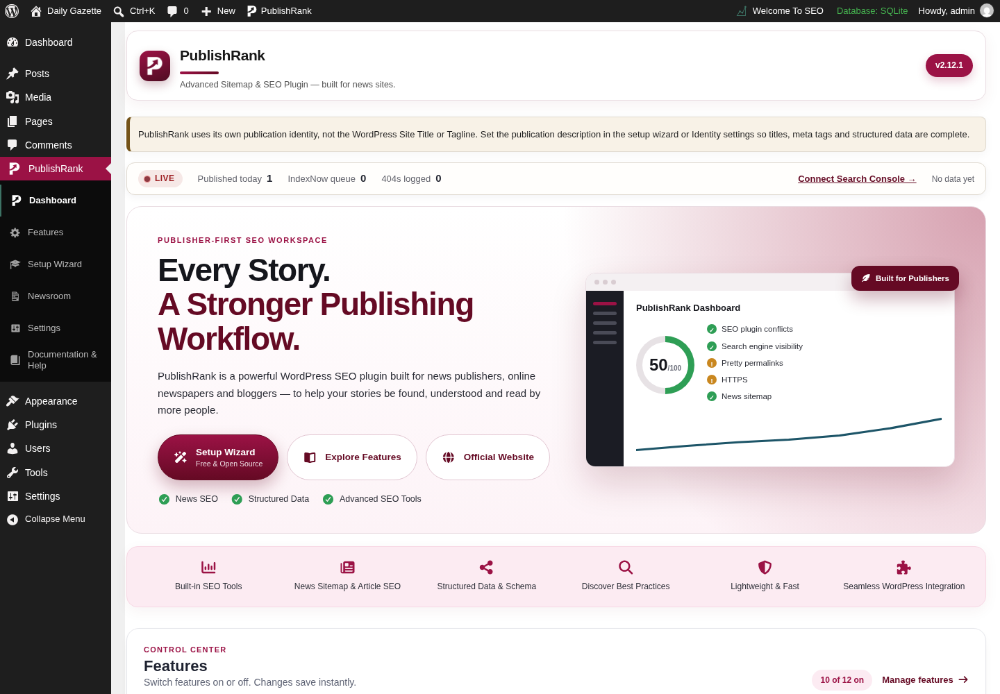
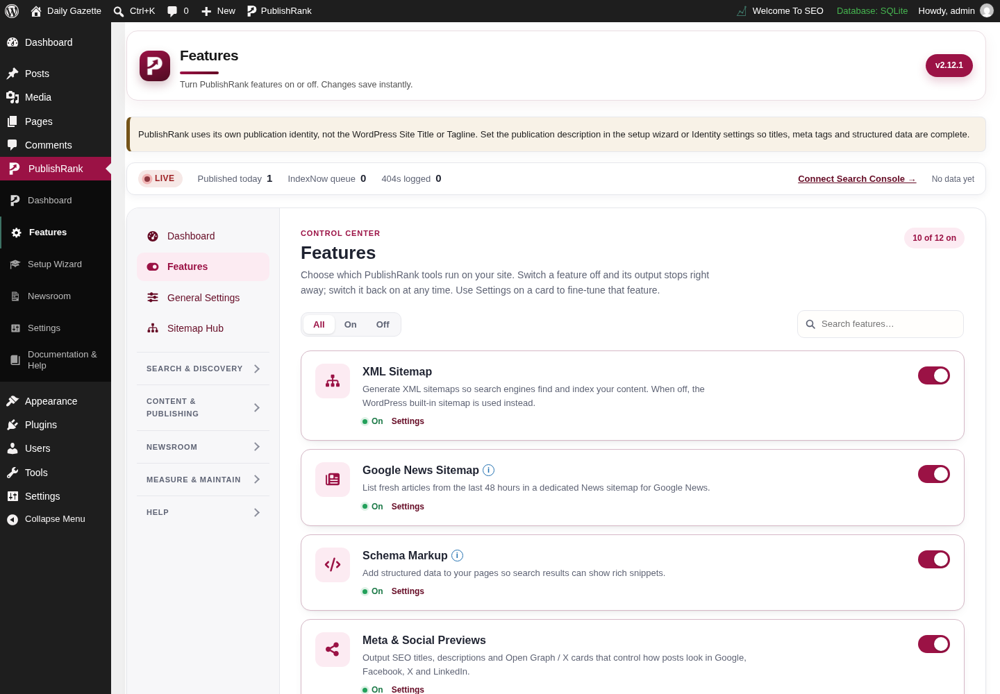
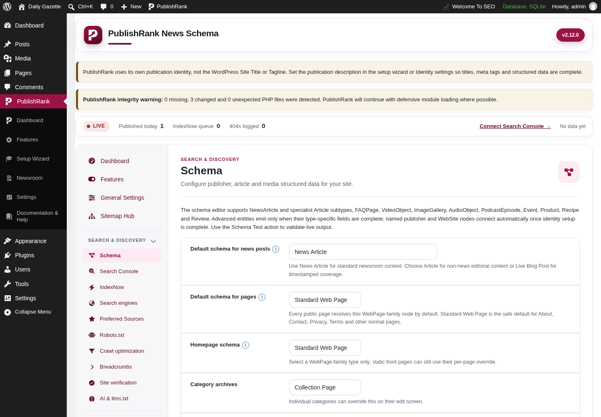
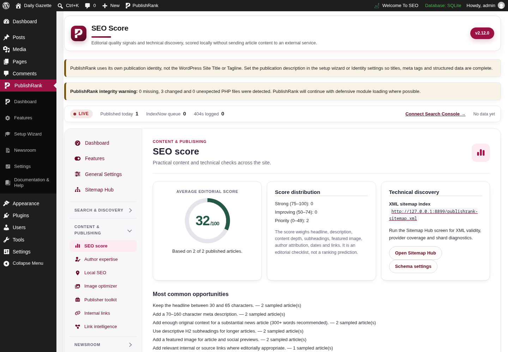
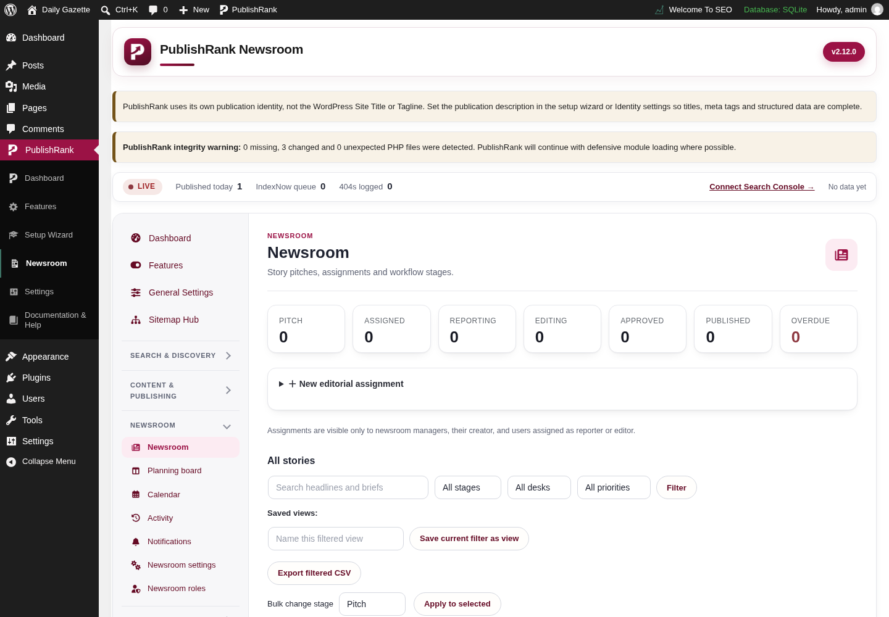

# PublishRank SEO for WordPress

## What's new in 2.26.1

PublishRank 2.26.1 is the current release. Read the [2.26.1 change history](https://publishrankseo.vercel.app/changelog#v2-26-1), the [verification report](docs/release-2.26.1/VERIFICATION-REPORT.md), and the [previous 2.26.0 release video](https://publishrankseo.vercel.app/video).

<p>
  <a href="https://raw.githubusercontent.com/Umarjaum/PublishRank/main/docs/media/publishrank-introduction.mp4"></a>
</p>
<p><a href="https://raw.githubusercontent.com/Umarjaum/PublishRank/main/docs/media/publishrank-introduction.mp4">Play the full 15-second introduction with audio (MP4)</a></p>

<p><strong>Second introduction · version 2</strong></p>
<p>
  <a href="https://raw.githubusercontent.com/Umarjaum/PublishRank/main/docs/media/publishrank-introduction-v2.mp4"></a>
</p>
<p><a href="https://raw.githubusercontent.com/Umarjaum/PublishRank/main/docs/media/publishrank-introduction-v2.mp4">Open the full 15-second version 2 introduction (MP4)</a></p>


**Free and open-source WordPress SEO for businesses, stores, creators, publishers and websites of every kind.**

PublishRank combines technical SEO, metadata, connected structured data, sitemaps, Local SEO, WooCommerce SEO, redirects, security, analytics and optional editorial workflows. SEO tools provide publishing signals and controls; search engines may still rewrite or omit titles, descriptions, images, snippets and rich-result presentations.

The maintainer reports feature checks passing on the latest WordPress and PHP versions tested across multiple business categories and news sites. These additional tests are separate from the version-specific checks documented in each release report; hosting, themes and other plugins can still affect compatibility.

## Current release
- **Version:** 2.26.1
- **License:** GPLv2 or later
- **Requires WordPress:** 6.3 or newer
- **Requires PHP:** 7.4 or newer (the report distinguishes runtime tests from static syntax scanning)
- **Repository:** <https://github.com/Umarjaum/PublishRank>
- **Release downloads:** <https://github.com/Umarjaum/PublishRank/releases>
- **Direct plugin download:** <https://github.com/Umarjaum/PublishRank/releases/download/v2.26.1/PublishRank-2.26.1.zip>
- **Official website:** <https://publishrankseo.vercel.app/>
- **Developer:** <https://umarjaum.vercel.app/>
- **WordPress.org listing:** <https://wordpress.org/plugins/publishrank/>

### 2.26.1 release highlights
- **A tidier dashboard** with clearer site metrics, compact feature cards and technical-health rows that stack on phones.
- **One Gutenberg SEO editor** in the persistent sidebar, with saved preferences, live Google and social previews, and a movable/resizable window that can be minimised or docked. Duplicate SEO boxes below Gutenberg are removed; Classic Editor retains its consolidated box.
- **Media Link Manager** for locating references and reviewing URL changes before applying them; it checks collisions, verifies migrations, supports redirects and rollback, and reports ambiguous references instead of guessing.
- **Advanced 404 diagnosis** with own-site linking pages, likely causes and redirects only for high-confidence fixes.
- **A reviewable Bulk SEO Editor** with conflict checks, change history and undo, plus safeguarded CSV import/export.
- **Schema Studio refinements** and improved YouTube/Vimeo video-sitemap discovery.
- **Responsive/accessibility refinements**, including focus, target-size, reduced-motion and forced-colours handling.

**Verification:** the 2.26.1 report documents sandbox testing on WordPress 7.1.5, PHP 8.3 and SQLite. It explicitly does not claim production-host testing. PHP 7.4 received static syntax scanning only; WooCommerce, builders, multilingual plugins, real phones and Safari/Firefox were not tested. Automated accessibility checks were spot checks, not a full WCAG audit. See the [complete 2.26.1 report](docs/release-2.26.1/VERIFICATION-REPORT.md) for findings, blocked items and limitations.

This report remains the record of that release’s specific sandbox test scope. Separately, the maintainer reports broader testing on the latest available WordPress and PHP versions across multiple business categories and news sites, with feature checks working as expected. This is not a guarantee that every hosting, theme or plugin combination will behave identically.

## Historical release: 2.25.1
- Traffic Guard monitor/enforce modes and country controls; an FAQ block and reusable collections; SEO Inspector and validated custom schema; Source Directory; Access Shield refinements; update/news notifications.
- The [2.25.1 verification report](VERIFICATION-REPORT-2.25.1.md) records that release's specific checks and scope. It does not replace the 2.26.1 report.

## What's new in 2.25.0
- **Theme masking:** maximum-level theme identifier rewriting, fingerprint scan and compatibility checks across nine listed themes; direct static theme files still require a server rule.
- **Role-based feature access:** role and per-user permissions, presets, an audit log and administrator lockout protection.
- **Access Shield:** signed live verification report, login protections, optional two-factor and CAPTCHA paths, and security event analytics.
- **Publishing Desk:** duplicate headline warning, missed-schedule detection/repair, freshness view, News diagnostics and publishing velocity.
- **Site identity:** PublishRank logo, WordPress Site Logo/Site Icon, title, tagline and description synchronization.
- **SEO and scale:** 15 additional article trust checks, independently rebuilt sitemap shards and an option preloader (measured on the report's test site).
- **News & What's New:** validated, cached release feed with bundled changelog fallback; it does not install plugin updates.

Older changelog details are preserved in the [2.23.0-and-earlier history archive](docs/release-archive/README-changelog-archive.md).

## Actual interface screenshots

These are real WordPress-admin captures from the earlier 2.25.0 interface set. They are historical examples, not new 2.25.1 screenshots:











See the [full official interface screenshot gallery](https://publishrankseo.vercel.app/features#product-screenshots) for the complete set of dashboard, SEO, schema, sitemap and newsroom screens.

## Highlights

### SEO and metadata

- SEO titles and descriptions with shared template variables.
- Canonical URLs, robots directives, Open Graph, and X/Twitter metadata.
- Hreflang and language alternates.
- Locale-aware per-post SEO overrides for titles, descriptions, focus keywords, Open Graph data, and robots directives, with a broad LTR/RTL language catalog and arbitrary WPML, Polylang, or hreflang-map locales supported. Urdu (`ur` / `ur-PK`) is included.
- Live Search, Website, Social, Meta, and JSON-LD previews.
- Per-post and per-page overrides with capability and nonce checks.
- Migration & Portability with preflight counts, merge/overwrite policies, source-data preservation, sanitized imports, normalized JSON exports, and an improved contrast and mobile layout.

### Mastodon verification and sharing

PublishRank can add the website URL to a Mastodon profile field and emit the reciprocal `rel="me"` link in the website HTML head. The Mastodon settings page shows a copyable `<link rel="me" href="…">` snippet for manual use, plus token-based verification status and publishing controls. Mastodon checks the field after the profile is saved. The access token is encrypted at rest, hidden by default, and can be revealed by an administrator with the eye button. A failed connection check does not erase the saved token. Sharing is recorded as complete only after Mastodon returns a status ID, including when a private post has no public URL.

### Connected structured data

PublishRank produces a connected JSON-LD graph rather than unrelated duplicate blocks. Depending on content and configuration it can publish Organization, Person, WebSite, WebPage, Article, NewsArticle, BlogPosting, BreadcrumbList, ImageObject, VideoObject, FAQ, Event, Recipe, Review, Product, LocalBusiness, and related entities.

The public Schema Aggregator is available at:

```text
/wp-json/publishrank/v1/schema-aggregator
```

The endpoint includes only public, published, indexable content. Template variables such as `%%focus_keyword%%` and `%%excerpt%%` are resolved before descriptions are returned; unresolved editor tokens are never exposed in the public feed.

### XML and News sitemaps

PublishRank provides a human-readable XSLT view backed by standards-compliant XML:

```text
/publishrank-sitemap.xml
/publishrank-post-sitemap-1.xml
/publishrank-news-sitemap-1.xml
/publishrank-sitemap.xsl
```

The sitemap index includes responsive cards, content-type badges, child-file counts, URL counts, last-modified information, a copy-link action, raw XML access, and a robots.txt shortcut. The readable view is for people; search engines receive the underlying XML.

### Redirects, crawl controls, and diagnostics

- Redirect rules with safe validation.
- Local 404 monitoring and grouped hit data.
- Robots.txt controls and crawl-budget hygiene.
- Sitemap health checks and frontend diagnostics.
- IndexNow and optional Baidu submission workflows.
- Optional traffic controls.
- **Access Shield:** configure a private sign-in address and sign-in protections from PublishRank’s own security settings.

### Publisher and newsroom workflows

- Publisher identity and social profiles.
- Author expertise and author schema fields.
- Newsroom assignments, stages, deadlines, calendar, activity, and notifications.
- SEO score cards, internal-link recommendations, and publisher toolkit controls.

## Complete feature catalog

The [2.26.1 verification report](docs/release-2.26.1/VERIFICATION-REPORT.md) documents the current release's test results and limits. The [2.25.1 feature catalog](docs/release-2.25.1/FEATURE-CATALOG.md), [verification report](VERIFICATION-REPORT-2.25.1.md), [security audit](docs/release-2.25.1/SECURITY-AUDIT.md) and [compatibility report](docs/release-2.25.1/COMPATIBILITY-REPORT.md) remain available as historical documentation. Earlier releases and all 134 selectable Local SEO business options remain covered in the historical changelog; the options are not 134 separate Schema.org classes.

## WordPress installation

1. Download the latest ZIP from [GitHub Releases](https://github.com/Umarjaum/PublishRank/releases).
2. In WordPress, open **Plugins → Add New → Upload Plugin**.
3. Upload the ZIP, install it, and activate **PublishRank**.
4. Open **PublishRank → Setup Wizard** and complete the site and business identity, SEO, social, search, and content-scope steps.
5. Review **PublishRank → Settings**, **Schema**, **Sitemap Health**, and **Robots.txt** before production use.
6. Submit `/publishrank-sitemap.xml` to Google Search Console and other webmaster tools when ready.

For an update, back up the site, upload the new ZIP, and allow WordPress to replace the existing plugin. Clear page, object, CDN, and browser caches after activation.

## New admin navigation in 2.9.104

The PublishRank menu is organized into expandable groups:

- **Content & publishing** — SEO score, author expertise, publisher tools, images, internal links, and local SEO.
- **Newsroom** — editorial workspace, board, calendar, activity, notifications, settings, and roles.
- **Search & discovery** — Search Console, sitemap health, IndexNow, verification, schema, breadcrumbs, robots, crawl optimization, and llms.txt.
- **Measure & maintain** — analytics, insights, redirects, 404 monitoring, traffic guard, login protection, configuration history, and diagnostics.
- **Settings & support** — titles and meta, import/export, setup wizard, and documentation.

Each tool has a native Dashicon inside a high-contrast colored tile. The colors are decorative only; the text label remains the authoritative accessible name. Group toggles are real buttons with `aria-expanded` and `aria-controls`, and keyboard focus is visibly styled.

The navigation fix also keeps every registered submenu destination in WordPress's `$submenu` registry. Dashboard cards and toolbar shortcuts therefore remain authorized when they open a direct `admin.php?page=...` URL.

## Breadcrumbs

PublishRank breadcrumbs support Home-first trails, category and parent-page hierarchies, separators, visibility controls, placement, current-page labels, and BreadcrumbList JSON-LD. The visible trail and structured data are generated from the same hierarchy.

Typical article output:

```text
Home → Category → Article title
```

Typical nested page output:

```text
Home → About Us → Editorial Team
```

The publication name remains available for titles, publisher identity, Open Graph, and WebSite/Organization structured data; it is not required to be a breadcrumb item.

## Template variables

The shared resolver supports variables including:

```text
%%title%%
%%sitename%%
%%site_description%%
%%category%%
%%primary_category%%
%%author%%
%%date%%
%%modified%%
%%excerpt%%
%%sep%%
%%page%%
%%id%%
%%permalink%%
%%focus_keyword%%
```

Templates are sanitized without corrupting percent-delimited tokens. Unknown variables are removed rather than printed literally. Descriptions use a safe fallback when the resolved value is empty.

## Architecture

```text
publishrank.php                 Bootstrap, hooks, version metadata
src/Core/                       Installer, branding, output settings, plugin boot
src/Admin/                      Dashboard, settings, onboarding, diagnostics, tools
src/Meta/                       Titles, descriptions, canonicals, robots, templates
src/Schema/                     Connected JSON-LD and public schema endpoints
src/Sitemap/                    XML providers, cache, audit, XSL stylesheet
src/SEO/                        Breadcrumbs, article intelligence, social and editorial SEO
src/Newsroom/                   Newsroom workflow and editorial actions
src/Security/                   Admin access, traffic guard, integrity and headers
assets/css/                     Shipped admin, sitemap, editor and frontend styles
assets/js/                      Shipped admin, editor, preview and navigation scripts
assets/images/                  Local brand and interface assets
tests/                          Standalone regression and integration checks
docs/                           Feature, architecture, privacy and release documentation
```

The plugin has no mandatory build step and ships first-party JavaScript and CSS in readable form. Font Awesome Free is bundled locally where used; the refreshed admin menu uses WordPress-native Dashicons so it does not depend on a third-party icon CDN.

## Development

Clone the repository and inspect the current branch:

```bash
git clone https://github.com/Umarjaum/PublishRank.git
cd PublishRank
```

Useful checks:

```bash
# Run the standalone test suite when a WordPress test environment is configured.
php tests/run.php

# Build an installable ZIP.
python3 tools/build_plugin_zip.py

# PHP syntax check for changed files.
php -l publishrank.php
php -l src/Admin/AdminAssets.php
php -l src/Admin/DashboardPage.php
php -l src/Schema/SchemaAggregator.php
```

The plugin uses WordPress APIs for capabilities, nonces, settings, REST permissions, escaping, URL validation, scheduled work, and cache invalidation. Do not test destructive settings changes on a production database.

## Extension points

Common filters and actions include:

- `publishrank_seo_post_data`
- `publishrank_schema_graph`
- `publishrank_seo_robots`
- `publishrank_seo_meta_box_post_types`
- `publishrank_schema_speakable_selectors`
- `publishrank_breadcrumb_schema_external_owner`
- `publishrank_sitemap_providers`
- `publishrank_seo_after_admin_header`
- `publishrank_seo_admin_toolbar_items`

Review the source and `docs/DEVELOPER-HOOKS.md` before extending output behavior.

## Compatibility and ownership

Use only one plugin as the owner of each public title, canonical, robots, Open Graph, and schema output layer. Running multiple SEO plugins with overlapping output can create duplicate or conflicting metadata.

PublishRank is designed for WordPress 6.3+ and PHP 7.4+. Always stage upgrades, check active theme integrations, clear caches, and review rendered HTML, JSON-LD, robots.txt, and XML sitemaps after updating.

## Privacy and external services

Core metadata, schema, redirects, sitemap generation, and diagnostics run locally. Optional integrations such as Google Search Console, IndexNow, Baidu, or external-link diagnostics make network requests only after an administrator configures or explicitly starts them. Review the provider documentation and your site's privacy obligations before enabling them.

## Release process

1. Update the plugin header and `PUBLISHRANK_SEO_VERSION` in `publishrank.php`.
2. Update `readme.txt` stable tag and changelog.
3. Add a release entry to `changelog.txt` and relevant `docs/` notes.
4. Run syntax checks and the standalone test suite where available.
5. Build the ZIP with `python3 tools/build_plugin_zip.py`.
6. Commit with a descriptive message and create a matching Git tag.
7. Publish GitHub release notes with the ZIP attached.

## License

PublishRank is distributed under the GPLv2-or-later license. See [LICENSE](LICENSE) and [LICENSE.txt](LICENSE.txt).
